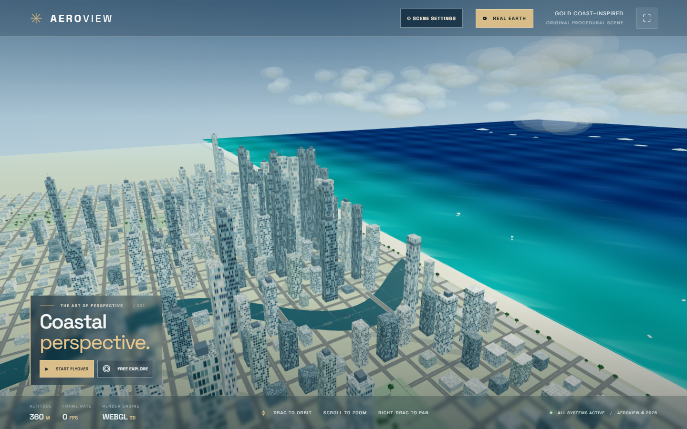
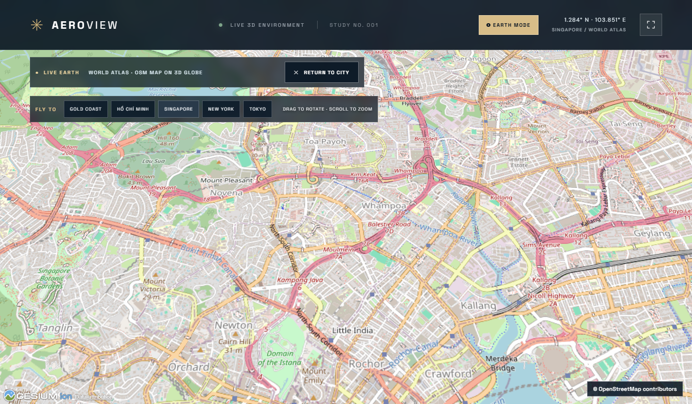
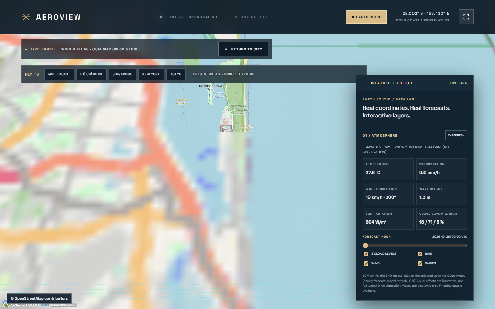
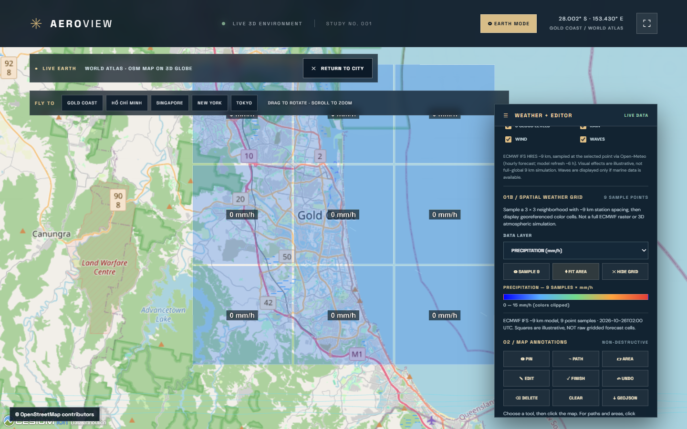
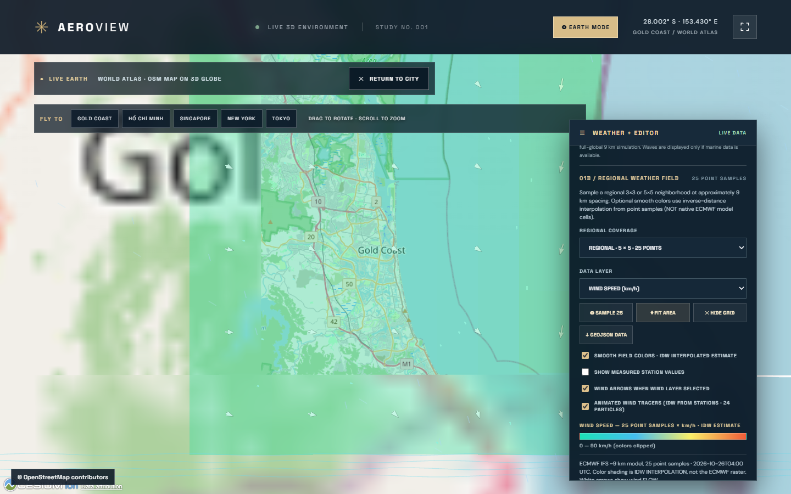
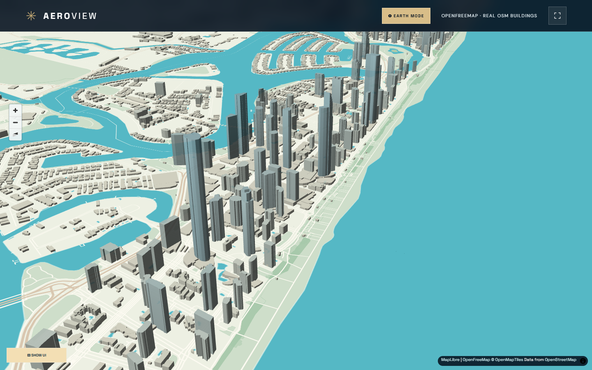

# AEROVIEW — Coastal Metropolis 🌊

A polished, immersive 3D city demo inspired by coastal aerial flyover visuals. Powered by **Three.js**, **Vite**, and procedural real-time geometry. No paid APIs, Google tiles, external map data, logins, or secrets.





## Features

- 🌇 Procedural coastal city with **1,077 buildings, 9,360 window instances, animated water and 375 cloud instances**
- 🌍 Optional **REAL EARTH** mode: Cesium globe + real OpenStreetMap street-map imagery on request (not photorealistic)
- 🏙️ Optional Google Photorealistic 3D Tiles mode for users who explicitly provide their own billable, restricted Map Tiles API key
- 🎬 Cinematic auto-flyover plus free orbit, pan and zoom
- ⚡ Batched ground geometry and instanced cloud / rooftop meshes (~48 WebGL draw calls in test view)
- 🎛️ Click QUALITY to cycle AUTO → ECO → BALANCED → ULTRA; AUTO reduces resolution on slow clients
- ☀️ Dawn / Day / Sunset / Night and volumetric-look atmospheric haze
- 🏙️ Camera presets: Skyline, Top Down, Coastline, Street
- ✨ Window lighting, palms, tidal waterways, boats, cloud layers
- 📱 Responsive UI with tested touch scrolling on 390 px and 768 px viewports
- 🔐 No third-party map data or API key; all geometry generated in the browser

## Run locally

```bash
npm install
npm run dev
```

Open [http://localhost:5188](http://localhost:5188). The development and preview servers bind to loopback only; the public production site is hosted separately on GitHub Pages.

```bash
npm test
npm run build
npm run test:browser  # Chrome automated WebGL interaction test
npm run test:mobile   # 390px and 768px simulated touch scrolling tests
npm run test:earth    # Real-world atlas/CDN, modal and no-key security checks
```

## Publish on GitHub Pages

```bash
npm run build:pages
```

Serve the repo's `/docs` directory from the `main` branch in GitHub Pages. The built asset base is `/aeroview-coast-3d/`. The deployment has no GitHub Actions workflow file by design.

## Performance notes

Three.js requires WebGL. On GPU-backed computers and mobile devices, performance depends on GPU. On WIN11-181, the desktop session reports **Microsoft Remote/Basic Display Adapter** (no confirmed hardware GPU), and the Chrome headless software renderer measured **~3 FPS** at 1440×900 while a typical GPU-backed client may be much faster. The 3D scene is original and illustrative — **not** a reconstruction of a real city or the original Facebook video's full assets.

## License

MIT


## REAL EARTH experience (optional)

Select **REAL EARTH** in the top bar. Two distinct providers are available:

1. **WORLD ATLAS** — real OpenStreetMap cartographic tiles draped on a Cesium 3D globe. **No user API key or billing required**. This provides *real-world geographic streets*, not 3D building geometry or Google aerial photos. Tiles load from `tile.openstreetmap.org` only on explicit activation, with visible © OpenStreetMap contributors attribution. Do not bulk-download or prefetch map tiles.
2. **PHOTOREAL 3D TILES** — real photogrammetric cities using Google's Map Tiles API with CesiumJS. You must have enabled the Map Tiles API and billing in your own Google Cloud project, configured daily quotas, and supplied your own **HTTP-referrer-restricted browser key**. The key is held only in page memory, not saved, uploaded, or committed to Git. Network requests to Google necessarily transmit the key (visible to the browser/devtools); never use an unrestricted key.

Cities available in either mode: Gold Coast, Ho Chi Minh City, Singapore, New York and Tokyo. Coverage for Photoreal 3D Tiles varies by region. The globe can be closed to return to the original coastal demo.

**Important:** Atlas mode was browser-tested with live OpenStreetMap tiles. Live Google 3D rendering cannot be end-to-end tested without an authorized billed key. The no-key and consent guards are tested. This application does not include or obtain an API key for you.

**Cesium runtime** is loaded from the version-pinned jsDelivr `cesium@1.145.0` CDN *only on activation*, so the default procedural experience remains lightweight and available even if the CDN is offline. CesiumJS is Apache-2.0 licensed.

References:
- https://cesium.com/learn/cesiumjs-learn/cesiumjs-quickstart/
- https://developers.google.com/maps/documentation/tile/usage-and-billing
- https://developers.google.com/maps/documentation/tile/3d-tiles
- https://operations.osmfoundation.org/policies/tiles/


## WEATHER + EDITOR — v1.1 studio preview

Click **REAL EARTH → WORLD ATLAS → LAUNCH EARTH VIEW** and open the right-hand **WEATHER + EDITOR** panel.



### Verified implementation

- **ECMWF IFS HRES 9 km** *point forecasts* from Open-Meteo's ECMWF endpoint. This is a genuine sampled model at the visible camera coordinates, not a complete world-spanning 9 km volume/grid. It exposes temperature, rain, wind, wind direction, gusts, solar irradiance, and low/middle/high cloud-cover percentages. Time slider lets you explore up to 24 forecast hours.
- **Marine forecasts** from Open-Meteo Marine API: wave height, if available for the sampled point. "N/A" is shown inland or when data is absent.
- **Visual effects:** three layered cloud/haze gradients, animated wind streaks, rain and ocean-wave strokes, driven by the current forecast sample. The *visual renderer is illustrative* and is **not** a scientific 3D atmospheric fluid solver, global cloud volume, ray-traced waves or a 9 km weather field.
- **Editing:** PIN, PATH and AREA overlays on Cesium, EDIT mode with draggable yellow vertex handles, selection/deletion, undo, clear, and export to GeoJSON in WGS84/EPSG:4326. **Non-destructive overlays only:** no modification of the actual Google 3D tiles or original terrain mesh.
- **Camera:** add 2+ current camera viewpoints, play/stop a cinematic flight. Download PNG screenshots, record a maximum-20-second WebM (browser permitting). Exports combine the map canvas, weather effects and explicit OSM/Cesium/weather attribution. They do not include the HTML editor panel.
- **Photoreal Google 3D:** camera and annotations work with an authorized Google key. PNG/WebM export is **disabled** in this mode because recording without the required Google branding/attribution could violate the Google Map Tiles API policies. A separately approved attribution-compliant recording implementation is needed.

### Data sources and production terms

- [Open-Meteo ECMWF model documentation](https://open-meteo.com/en/docs/ecmwf-api) — full-resolution 9 km IFS HRES runs approx every 6 hours; the hourly API interpolates/provides forecast timestamps. The app refreshes its *point samples* as the viewer moves (at most one coordinate-request cycle about every 45 seconds except manual/city refresh) and permits manual refresh. It does **not** claim the underlying model is updated each minute.
- [Open-Meteo terms](https://open-meteo.com/en/terms) — free hosted API is for non-commercial use, with rate limits; commercial or heavy usage requires a suitable agreement/subscription or your own infrastructure. Weather data is offered under CC-BY 4.0 with attribution.
- [OSM tile usage policy](https://operations.osmfoundation.org/policies/tiles/) — provide visible credit, respect browser HTTP caching and request only actively viewed tiles. Public OSM Foundation tile servers are not production infrastructure for heavy traffic. Use an appropriately licensed map-tile provider for scale.
- [Google Map Tiles API policies](https://developers.google.com/maps/documentation/tile/policies) — preserve all Google/third-party credits and logos, respect caching/export/use restrictions and enabled billing.
- Any generated weather-driven imagery or video is an **illustrative visualization of point model data**, and should not be advertised as a full scientific global forecast simulation.

### Reproducible tests on WIN11-181

```powershell
npm test
npm run build:pages
npm run test:earth
npm run test:studio
npm run test:capture
npm run test:mobile
npm run test:studio-mobile
```

These tests use the installed Chrome browser with software WebGL fallback. Actual smoothness and quality need assessment on a machine with a capable GPU. No GitHub Actions pipeline is required.


## SPATIAL WEATHER GRID + GEOJSON BUILDINGS (v1.2)



### Spatial weather mapping (nine point samples)
Open REAL EARTH → WORLD ATLAS → WEATHER + EDITOR → 01B / SPATIAL WEATHER GRID. Click SAMPLE 9 to request a 3 × 3 collection of point forecasts centered on the Cesium camera, with sampling points spaced approximately 9 km apart. This is one bounded multi-coordinate Open-Meteo API request. Select TEMPERATURE, PRECIPITATION, WIND SPEED or CLOUD COVER; change forecast hour, FIT AREA, or HIDE GRID.

IMPORTANT: The colored rectangles represent samples in neighboring locations, not ECMWF's native 9 km grid cells, a continuous weather field, or scientifically validated interpolation. No claims are made about fine-scale weather variation between stations. Live multi-point sampling is user-initiated and limited to one request per 45 seconds per browser view. Open-Meteo noncommercial API limits and attribution requirements apply.

### GeoJSON building extrusion
In 02C / 3D BUILDING FOOTPRINTS, import your own appropriately licensed EPSG:4326 GeoJSON FeatureCollection containing Polygon or MultiPolygon building footprints. The browser extrudes using height or building:height when present; otherwise it estimates building:levels × 3 m, or explicitly assumes 12 m when height metadata is absent. Estimated heights are marked as estimates. Limits: 500 polygons, 18,000 vertices, 3 MB per file. Hide/show/remove affects only your overlay.

This does NOT automatically download OpenStreetMap buildings, reconstruct a photorealistic city, modify Google imagery, or assert imported footprints are authoritative. You are responsible for obtaining and licensing geographic files.

### Save and open a local project
02B / PROJECT FILE allows you to download and reopen aeroview-project.json, saving PIN, PATH and AREA annotations and cinematic camera keyframes. Project format v2 also saves locally imported 3D building footprints, their height assumptions, layer visibility, and camera transition seconds. Version v1 files remain supported. It still excludes API keys, map imagery and live weather forecast responses. Input schemas, coordinate ranges, file sizes and record counts are validated before existing annotations are replaced. Project content is never uploaded by this feature.

### Verification and limitations
Run npm run test:grid-project on 181 for nine live weather samples, layers, malformed project protection, building GeoJSON import/toggle/clear and saved camera-keyframe restoration. The test building polygons are synthetic fixtures, NOT actual city geography. True realistic photogrammetric surfaces require an authorized map provider, billing where applicable, attribution compliance and GPU performance verification. The Facebook reference's global volumetric clouds and full atmospheric solver are not implemented in this demo.


## V3 — WIND FIELD, WEATHER EXPORT AND PORTABLE SCENE PROJECTS

### Wind flow visualization
On the nine-point ECMWF spatial weather grid, choose WIND SPEED. White arrows point toward the direction of flow, derived from the meteorological direction FROM plus 180 degrees. They indicate nine forecast vectors only, not continuous streamlines or a three-dimensional wind solver. Toggle WIND ARROWS without making more weather API requests.

### Nine station points as GeoJSON
The GRID → GEOJSON DATA button exports the selected UTC forecast hour as nine georeferenced GeoJSON Point features. Their properties include temperature, precipitation, wind speed, meteorological wind direction, cloud cover, forecast time and explicit point-sample provenance. These data are neither the native ECMWF model grid nor a continuous global forecast.

### Scene project format v2
SAVE PROJECT now preserves annotation geometry, camera keyframes, configurable per-waypoint transition seconds, imported building footprint polygons, building heights and estimated-height flags, and building layer visibility. OPEN PROJECT supports both version 1 and version 2 with validation before editing the existing scene. The file does not embed Google/OSM map images, Google API keys or live weather provider responses. Local JSON load limit is 8 MB, with geometry complexity limits enforced. PROJECT RESET also clears user-supplied building meshes.

### Testing
On WIN11-181 run npm run test:v3 for 24 assertions: wind vector controls, weather GeoJSON export, no extra API fetch on layer changes, project v2 save/restore, invalid-data rejection and v1 backward compatibility. Run the desktop, Cesium Earth, mobile, studio and capture regression tests too.

NOT YET IMPLEMENTED: true worldwide 9 km atmospheric data cubes, scientifically resolved volumetric clouds, physically accurate waves, global wind particle advection, automatic licensed photorealistic building data, or original Facebook-author source assets.

## V4 — 24-hour weather playback and locally interpolated wind tracers

### How to use

Open **REAL EARTH → WORLD ATLAS → WEATHER + EDITOR**. After point-forecast data loads, use **PLAY 24H** to advance one cached forecast hour at a time. The timeline has Pause, Restart, Slow / Normal / Fast and optional Loop controls. Its changes are shared between the point weather panel, visual precipitation/cloud effects and the sampled geospatial grid when present. **Playback never requests additional weather API data.** If the browser tab becomes hidden or the Earth viewer is closed, the animation pauses and timers are released.

To render wind movement, choose **SPATIAL WEATHER GRID → SAMPLE 9 → WIND SPEED**, and enable **ANIMATED WIND TRACERS**. Up to 24 cyan wind particles move over the 3×3 sample region. An inverse-distance weighting of the nine sampled meteorological vectors approximates horizontal wind **between** sample sites, with vector direction reversed from meteorological FROM to actual TO. They are intentionally switched off by default for older GPUs.

**Scientific limitation:** particle trajectories are animated *illustrations*, **not** ECMWF native vector fields, a calibrated flow/particle transport model or real-world displacement predictions. The animation exaggerates elapsed model time for visual clarity. Forecast playback advances discrete hourly samples; it does not interpolate in physical time or increase the meteorological model's refresh frequency.

### Lifecycle/performance

DOM event handlers for Weather, 9-Sample Grid, Building Overlay, Editor and Playback are tied to abort signals and cleaned up on closing Earth view. Wind particle intervals and primitives are removed when toggled off, changing map layers or leaving REAL EARTH. Repeatedly opening/closing the viewer therefore does not leave previously mounted control handlers active.

### Automated tests

- `npm run test:v4`: 14 checks for loading, moving 24 wind tracers, weather station coverage, playback controls, endpoint and reset behavior, no extra ECMWF request on playback, cleanup and JavaScript errors.
- `npm run test:lifecycle`: two full open/close cycles with editable map annotations, camera keyframes, reset controls and stale listener checks.
- Previous `npm run test:v3`, `npm run test:studio-mobile`, `npm run test:capture` and other regressions remain available.

No billed Google tiles or third-party secrets are required for V4 features. Google Photorealistic 3D still requires a separately authorized, restricted Map Tiles API key and a licensed, attribution-compliant workflow.


## V5 — regional ECMWF point forecasts (3×3 or 5×5) and IDW display

**Use:** REAL EARTH → WORLD ATLAS → WEATHER + EDITOR → REGIONAL WEATHER FIELD. Select **LOCAL (9 points)** or **REGIONAL (25 points)**, then press SAMPLE 9 / SAMPLE 25. Requests are explicitly user-initiated and limited to once every 45 seconds per viewer instance; switching layers, forecast hours, labels, smooth colors or wind animations does **not** make another weather API request.

The default 9-point mode remains unchanged. The 25-point mode samples a neighborhood at approximately 9 km between locations (about 45 × 45 km for 5 × 5 points). There is no worldwide 9 km data download; a multi-coordinate request to Open-Meteo returns up to 25 **individual modeled point forecasts**. Each point may be snapped to an ECMWF model grid location by the upstream service.

**SMOOTH FIELD COLORS** uses inverse-distance weighting (IDW) from these samples to visualize local variation as either 36 or 100 colored tiles. These tiles are *illustrative estimates, not ECMWF native grid cells, scientifically validated downscaling, or a continuous physically solved 3D weather field*. Original point values can be shown with the SHOW STATION FORECAST VALUES checkbox: the values are **model forecasts**, not physical observations. WIND SPEED displays meteorological flow-direction arrows; optional 24 animated tracers now work with 9 or 25 wind samples.

The GEOJSON DATA export includes the sampled point count and UTC forecast hour, with per-station WGS84 coordinates and explicit sample_type=point_forecast_not_native_grid metadata; interpolated tiles are **not exported as observed data**. The 25-point request consumes more of a weather API location-based quota than 9 points. Free Open-Meteo access is subject to noncommercial terms. No API key is built into this site.

**Tests:** npm run test:regional checks 14 behaviors using a real 25-point Open-Meteo response, including 100 IDW patches, wind vectors, tracer movement, GeoJSON provenance, no unexpected API requests during editing, cleanup and JavaScript errors. npm run test:v3, npm run test:v4 and npm run test:studio-mobile check backwards compatibility. Regional screenshot: regional-25-preview.png.



## Visual redesign — cinematic coastal study

The homepage now prioritizes the actual 3D scenery rather than the dashboard: a Gold Coast-inspired shoreline camera angle, bright midday lighting, turquoise nearshore water, deeper-blue ocean, surf ribbons, facade materials with windows and balcony details, softer cloud masses, architectural shadow overlays and a smaller caption. The technical panel is hidden initially; click **SCENE SETTINGS** to restore all camera, daylight, haze, quality and lighting controls. **REAL EARTH** and the weather/GIS editor remain available.

All procedurally generated pixels, buildings and textures are original to this demo and **not a geodetically correct reconstruction of Surfers Paradise or Google photogrammetry**. The reference video contains aerial terrain/buildings with much more realistic assets. Matching it closely would require an appropriately licensed 3D Tiles/photogrammetry/terrain dataset and capable GPU hardware. The existing opt-in Google Photorealistic 3D Tiles provider requires an authorized restricted API key and billing; the site does not contain or silently use one.

The remote WIN11-181 software-rendered WebGL session is severely GPU constrained (observed single-digit FPS); use a real GPU-enabled Chromium browser for practical visual quality. The quality button offers ECO / BALANCED / ULTRA, and AUTO scales resolution to prevent total stalls.


Regression tests: npm test, npm run test:browser, npm run test:mobile, npm run test:earth, npm run test:visual (new in V6), and optional historical GIS checks.


## V7 — Real 3D buildings via opt-in Cesium ion

AEROVIEW now offers three REAL EARTH modes:
- WORLD ATLAS: free OpenStreetMap 2D map on globe, no ion account.
- REAL 3D BUILDINGS (CESIUM OSM): geolocated OSM buildings and Cesium terrain, requires YOUR read-only Cesium ion token and explicit authorization.
- PHOTOREAL 3D (GOOGLE): requires YOUR Google Map Tiles API key and explicit opt-in for billable usage.

Unlike the invented coastal cubes on the homepage, Cesium OSM Buildings represents geographic building locations/footprints and approximate heights. However, it is NOT photogrammetry or a guarantee of visually photorealistic facade textures.

### Enable OSM 3D buildings
1. Obtain an assets:read token from https://ion.cesium.com/tokens and review license and usage quotas at https://cesium.com/platform/cesium-ion/pricing/.
2. Select REAL EARTH > REAL 3D BUILDINGS (CESIUM OSM), paste the token, authorize Cesium ion streaming and launch.
3. See streamed real-world buildings and terrain from your selected city. Use CINEMATIC FLIGHT / STOP for a designed camera path over geographic coordinates, NOT a recorded aircraft trajectory.
4. Exit Earth mode to destroy the viewer and clear the typed key. Keys are never persisted in localStorage, Git or exported projects. The token is used for authenticated requests directly by the client browser during the authorized session.

Cesium ion Community use is limited to personal/noncommercial projects and quotas; commercial use may require a paid license. See the provider's current pricing and terms. Google 3D Tiles is a separately billable service.

PNG/WebM export is intentionally disabled for both external 3D providers pending a provider-specific attribution, license and permission review. Atlas export with OSM credits remains enabled.

### Verification
- npm run test:osm-provider: verifies no unauthorized ion/Google requests, invalid key/consent blocking, atlas operation, movie camera controls, input clearing.
- npm run test:osm-mock: verifies the third-party initialization flow with mocked terrain and buildings, correct provider status, ion token restoration and no unintended ion calls.
- Neither test proves real authenticated streaming works: no real user token was available on WIN11-181.
- All existing regression tests for GUI, GIS editing, weather, capture and mobile should remain operational.

References: https://cesium.com/platform/cesium-ion/content/cesium-osm-buildings/ ; https://cesium.com/learn/ion/cesium-ion-access-tokens/ ; https://developers.google.com/maps/documentation/tile/policies


## V8 — Free live real-world 3D city (no token)

AEROVIEW now supports FREE REAL-WORLD 3D CITY using the open-source MapLibre GL JS renderer and the OpenFreeMap public OpenStreetMap-derived vector tiles. The building-3d layer is based on georeferenced footprints and render-height properties provided by the vector tile dataset. Unlike the procedural homepage scene, these footprints align with the actual city geography and coastline. They are **not** textured aerial photogrammetry, 3D scanned facades, Google imagery or full-resolution physics simulations.

### Try the new view

Select the REAL CITY 3D shortcut on the home screen, or use REAL EARTH → FREE REAL-WORLD 3D CITY → choose Gold Coast, Ho Chi Minh City, Singapore, New York or Tokyo → LAUNCH EARTH VIEW. No Cesium ion or Google API key is needed. Wait for the selected region's vector tiles to finish loading. Orbit/zoom with MapLibre controls, use the city shortcuts and CINEMATIC FLIGHT / STOP. Switch back to the procedural city using RETURN TO CITY. Weather and GIS overlays remain available in the separate Cesium World Atlas mode; they are not simulated inside this free MapLibre scene.

The customized lightweight style includes water, coastline, roads, park/landcover and extruded 3D buildings. It avoids external font/sprite loading. MapLibre's dedicated Web Worker is configured explicitly for Vite and shipped as a separate static bundle, allowing real vector tiles to render in browsers (including the 181 software-WebGL test environment). OpenFreeMap map data and attribution remain visible at the bottom of the viewport.

### Real-world caveats

OpenStreetMap vector building data can have incomplete heights, incorrect geometry or incomplete coverage in some locations. Do not use it for legal surveying, engineering placement or absolute building height calculations. Styling is illustrative and may differ from the Facebook photorealistic reference. OpenFreeMap offers free hosted public vector tiles, but for a high-traffic commercial website consider capacity and provider terms, or self-host the vector tile server. See https://openfreemap.org/ and https://openfreemap.org/quick_start/.

### Verification

Use npm run test:free-city. The automated browser test validates actual loading and rendering of building features (at least 20 geolocated 3D building footprints) from OpenFreeMap, tile/source load completion, visible attribution, user-directed camera flight/stop, location changes, cleanup and no requests to Cesium ion or Google. During the Gold Coast test on WIN11-181, 254 features were rendered in the viewport. The displayed screenshot is a test capture, not a photographic aerial image: free-city-preview.png.



Other modes remain: free OSM Atlas with weather and GIS editor, Cesium OSM 3D by explicitly authorized ion token, and Google Photorealistic 3D by explicitly authorized billable Google key. No secrets were added to Git or browser persistent storage.


## V9 — Geographic 3D: visual direction, cinematic composition, credited stills

The geolocated FREE REAL-WORLD 3D CITY scene now features:

- SKYLINE / COASTLINE / TOP DOWN camera presets. These are artist-directed camera angles around the currently selected city's real map coordinates, not recorded routes or authoritative survey camera locations.
- DAYLIGHT / GOLDEN HOUR / BLUE HOUR cartographic atmosphere presets. MapLibre sky/horizon/fog and the light, water, roads, parks and building colors change together. This is an illustrative appearance preset, NOT observed current or forecast weather.
- HIDE UI / SHOW UI for a clean full-screen map composition while keeping exit controls recoverable.
- PNG: an operator-initiated screenshot of the geolocated map canvas, with a mandatory footer naming OpenStreetMap contributors, OpenFreeMap and MapLibre. The renderer uses a buffer-preserving canvas for this explicit export; screenshots are never automatic.
- A live status showing loading progress and the number of rendered 3D footprints. The number is viewport-dependent, not the city's total buildings.

The imagery remains map-style OpenStreetMap vector extrusions, NOT actual photographic facade textures or the Facebook author's private simulation data. Atmosphere presets and a more open interface cannot turn these coarse objects into Google Photorealistic 3D Tiles.

Tests: npm run test:free-city validates actual 3D tiles, attributed PNG file, 3 atmospheres, top-down composition, focus mode and camera flight. npm run test:free-city-mobile checks the UI at 390 px. Existing Atlas, weather and project regressions should remain green.

References: https://maplibre.org/maplibre-gl-js/docs/examples/sky-fog-terrain/ ; https://openfreemap.org/tos/ . OpenFreeMap access is provided as is; use the service responsibly, retain the map's attribution and consider self-hosting if business traffic grows.


## V10 - attributed browser WebM recording

FREE REAL-WORLD 3D CITY supports user-triggered RECORD FLIGHT (12 seconds) and STOP & SAVE. Recording starts only when map building geometry is visible, composites the MapLibre canvas with permanent source credits, and exports WebM locally using MediaRecorder. It does not upload video frames, API keys or map data to AEROVIEW servers. Unsupported browsers receive a clear message.

Video attribution: OpenFreeMap © OpenMapTiles · Data from © OpenStreetMap contributors. This is map-based cartographic animation and NOT satellite imagery or photogrammetric reconstruction. See https://openfreemap.org/tos/ and https://openfreemap.org/ for the data service terms.

Run npm run test:free-city-video for a 4-second recorded WebM, verified EBML header, user-consented capture, valid download and no paid Google/Cesium API calls. A GPU software Chrome session may produce lower frame rates than hardware-accelerated video recording.

**Recorded V10 example:** [4-second Gold Coast camera flight WebM](https://trinhtanphat.github.io/aeroview-coast-3d/demo-flight-v10.webm) (browser-rendered vector 3D, with permanent source attribution). It is a short verification example and not a photorealistic map or full-quality production export.
